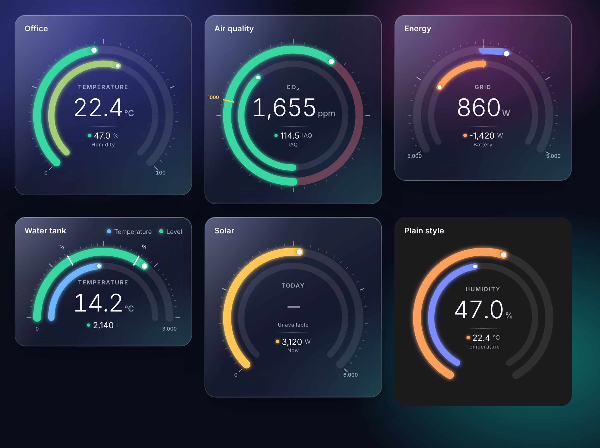
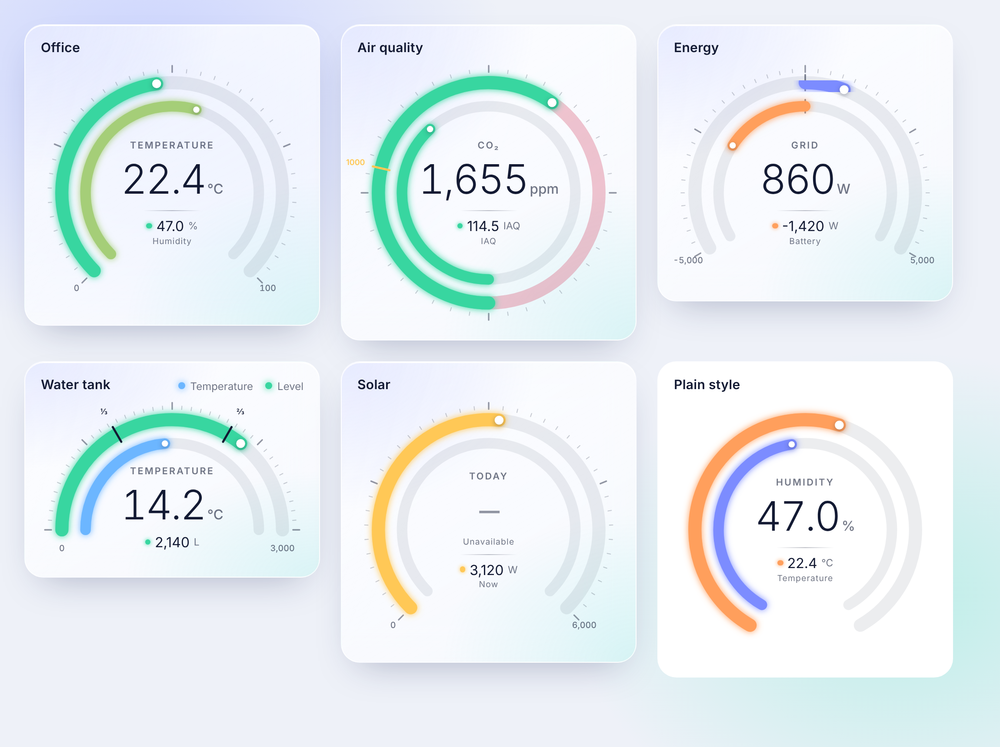
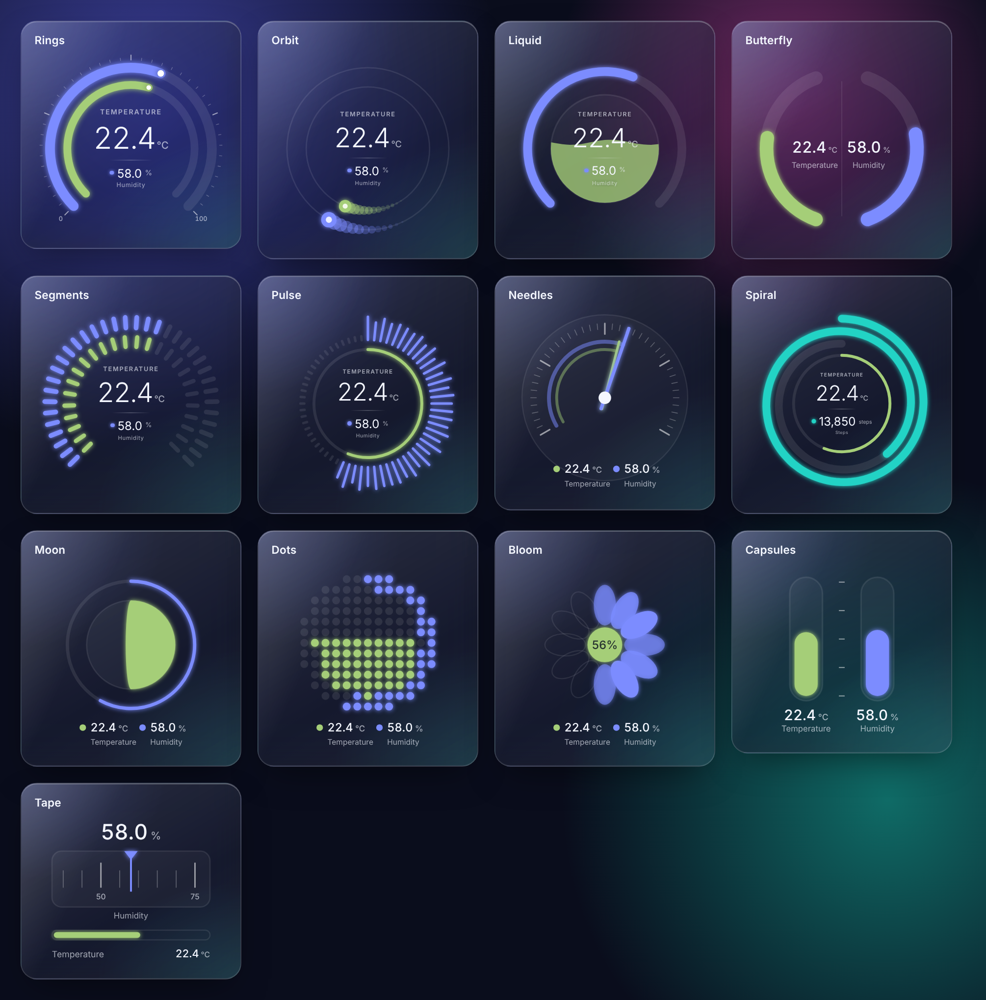
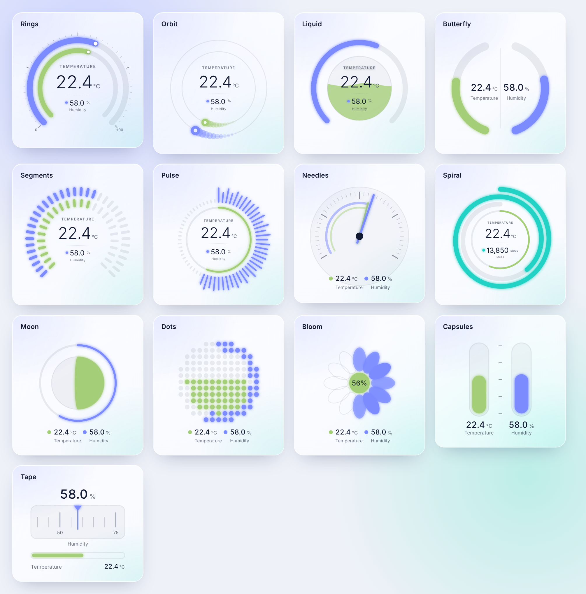

# Glass Dual Gauge

**Two values on one gauge, on a frosted-glass card for Home Assistant.**

The inner ring shows one sensor and the outer ring another, with a clear readout in the middle. It's made for pairs that belong together: temperature and humidity, CO₂ and air quality, battery and grid power, tank level and temperature.





## Styles

Pick from 13 designs, by tapping a thumbnail in the editor or with `style:` in YAML. All of them use the same two sensors, colour ranges and glass card, and tapping a value opens its history.



| Style | `style:` | First value | Second value | Good for |
|---|---|---|---|---|
| Rings | `rings` (default) | Inner ring | Outer ring | Anything; the most adjustable |
| Orbit | `orbit` | Inner moon | Outer moon | A playful look that's never "empty" |
| Liquid | `liquid` | Liquid level in the bowl | Arc around it | Tanks, humidity, battery |
| Butterfly | `butterfly` | Left wing | Right wing | Comparing two similar values, like inside and outside temperature |
| Segments | `segments` | Inner pills | Outer pills | Wall tablets; readable from across the room |
| Pulse | `pulse` | Thin inner ring | Spokes | Power, audio, anything lively |
| Needles | `needles` | Short needle | Long needle | Precise readings on one scale |
| Spiral | `spiral` | Inner ring | Spiral, up to 200% | Goals you can beat: steps, solar output |
| Moon | `moon` | Moon phase | Halo | A distinctive, calm look |
| Dot grid | `dots` | Centre dots | Edge dots | Percentages at a glance |
| Bloom | `bloom` | Petal size | Number of lit petals | Something decorative |
| Capsules | `capsules` | Left tube | Right tube | Two values with different units |
| Tape | `tape` | Bar | Scrolling scale | Wide, short spaces |

Notes:

- Liquid and Pulse move gently. The motion stops if your device is set to reduce motion.
- `arc` applies to Rings, Liquid and Segments. Ring thickness, spacing, tick marks, zones, markers and fill-from-zero apply to Rings only.
- In Spiral, the second value keeps winding past its `max`, up to twice the range.

<details>
<summary>All styles in light mode</summary>



</details>

## Features

- **Crisp, smooth rings.** Drawn as vector graphics, so they stay sharp on any screen, with a soft glow and a knob at the current value.
- **Clear centre readout.** One value large, the other underneath with a coloured dot that matches its ring.
- **Five shapes.** Full circle, 300°, 270° (default), 240° or half circle.
- **Colour ranges.** Stepped, or blended smoothly between colours.
- **Zones and markers.** Shade parts of a ring and mark important values with labels.
- **Fill from zero.** For values that go negative, like battery or grid power.
- **Light and dark.** Follows Home Assistant's theme automatically, or set it yourself. Turn off the glass for a plain card that matches any dashboard.
- **Tap for history.** Tapping a ring or a value opens that sensor's history.
- **13 styles.** From classic rings to liquid, needles, spirals and blooms. Switch with one tap in the editor.
- **Visual editor.** Ring thickness, spacing and colours are all adjustable with sliders and colour pickers, with quick palettes to start from. No YAML needed.
- **Lightweight.** One file, no dependencies.

## Install

### HACS

1. In HACS, open the menu (⋮) → **Custom repositories**.
2. Add this repository's URL with the type **Dashboard**.
3. Install **Glass Dual Gauge** and reload your browser.

### Manually

1. Copy `glass-dual-gauge.js` into your `config/www/` folder.
2. Go to **Settings → Dashboards → ⋮ → Resources** and add `/local/glass-dual-gauge.js` as a **JavaScript module**.
3. Reload your browser.

Then edit a dashboard, choose **Add card**, and pick **Glass Dual Gauge**.

## Quick start

```yaml
type: custom:glass-dual-gauge
name: Office
gauges:
  - entity: sensor.office_temperature   # inner ring
    min: 0
    max: 40
  - entity: sensor.office_humidity      # outer ring
    min: 0
    max: 100
```

The first gauge in the list is the inner ring and the second is the outer ring. More complete examples are in [examples.yaml](examples.yaml).

## Card options

| Option | Default | Description |
|---|---|---|
| `gauges` | required | Exactly two gauges: inner ring first, outer ring second. |
| `name` | — | Title at the top of the card. |
| `style` | `rings` | Which design to use. See [Styles](#styles). |
| `primary` | `inner` | Which ring's value is shown large: `inner` or `outer`. |
| `arc` | `270` | Gauge shape in degrees: `360`, `300`, `270`, `240` or `180`. |
| `theme` | `auto` | `auto` follows Home Assistant; or `dark` / `light`. |
| `glass` | `true` | Frosted-glass background. `false` uses your theme's normal card style. |
| `show_scale` | `true` | Tick marks around the outer ring, plus min and max at the ends. |
| `size` | `340` | Maximum gauge width in pixels. The gauge shrinks to fit smaller cards. |
| `ring_gap` | `9` | Space between the two rings, from `0` (touching) to `30`. |
| `track_color` | automatic | Colour of the empty part of the rings, shown faintly, like `"#ff5fa2"`. |
| `flip` | `false` | Put the first sensor on the outside and the second on the inside. |

## Gauge options

| Option | Default | Description |
|---|---|---|
| `entity` | required | A sensor, number, input_number or counter. |
| `name` | entity name | Label shown in the centre. |
| `unit` | entity unit | Overrides the unit. |
| `min` / `max` | `0` / `100` | Range of the ring. |
| `decimals` | automatic | Decimal places. Uses the entity's display precision if set. |
| `thickness` | `8` inner, `10` outer | Ring thickness, from `2` to `24`. Very thick rings shrink the gap and the centre text so everything still fits. |
| `color` | — | One colour for the whole ring, like `"#38d6a0"`. |
| `colors` | green / amber / red | Colour ranges (see below). |
| `color_mode` | `steps` | `steps` changes colour at each range; `gradient` blends between them. |
| `bidirectional` | `false` | Fill from zero instead of from `min`, for values that go negative. A small line marks zero. |
| `zones` | — | Shaded parts of the ring (see below). |
| `markers` | — | Lines across the ring at important values (see below). |

## Visual editor

In the dashboard editor you can set everything except zones and markers:

- **Style:** a thumbnail of every design, drawn in your own colours. Only the options that apply to the chosen style are shown, and each section is named after what it controls (for example "Left wing" and "Right wing" for Butterfly).
- **Rings style:** a thickness slider for each ring and a slider for the space between them.
- **Colours:** for each ring, pick **One colour** (colour picker plus a row of ready-made swatches) or **Changes with value** (a list of colours, each with the value it starts at). Add or remove colours, turn blending on or off, or start from a quick palette such as *Cool → hot* or *Good → bad*. A strip next to each ring's name previews the result.
- **Ring background:** the faint colour behind each ring, or automatic.

### Colour ranges

Each colour applies from its `from` value upwards:

```yaml
colors:
  - from: 0
    color: "#6cb6ff"   # cold
  - from: 18
    color: "#38d6a0"   # comfortable
  - from: 26
    color: "#ffc857"   # warm
  - from: 30
    color: "#ff5c7a"   # hot
color_mode: gradient
```

Without `colors` or `color`, the ring is green up to 60% of its range, amber up to 85%, and red above that.

### Zones

```yaml
zones:
  - from: 400
    to: 1000
    color: "#38d6a0"
    opacity: 0.3     # optional, 0 to 1
```

### Markers

```yaml
markers:
  - value: 1000
    label: "1000"    # labels are shown on the outer ring
    color: "#ffc857" # optional, defaults to the text colour
```

## License

MIT. See [LICENSE](LICENSE).
